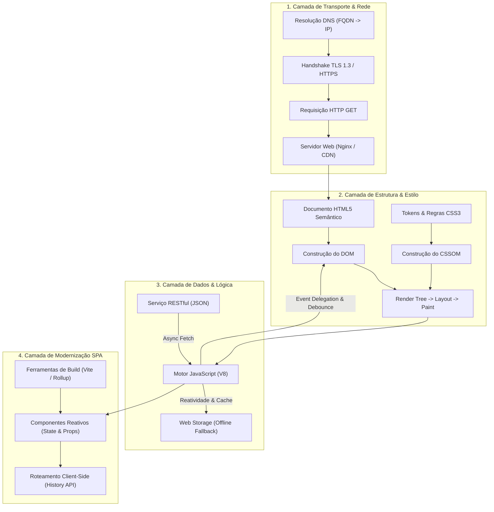

# Relatório Técnico-Conceitual: Arquitetura e Engenharia de Aplicação Front-End

**Curso:** Engenharia da Computação  
**Instituição:** Centro Universitário UniFatecie  
**Disciplina:** Desenvolvimento Front-End  
**Acadêmico:** Wallax Figueiredo  
**Projeto Aplicado:** Catálogo Interativo e Responsivo da Livraria Alexandria  

---

## Sumário Executivo

Este documento apresenta a fundamentação técnica e conceitual para a construção da interface web da Livraria Alexandria, desenvolvida como solução de catálogo online para uma *software house*. A solução aborda desde a camada de infraestrutura de rede e entrega de pacotes até a componentização reativa em Single Page Applications (SPA), contemplando semântica HTML5, WAI-ARIA, design responsivo moderno com CSS Grid e Flexbox, consumo assíncrono de APIs RESTful via JSON e estratégias de *bundling* e roteamento no cliente.



---

## a) Infraestrutura Web, Modelo Cliente-Servidor e Estrutura Semântica HTML

### 1. Modelo Cliente-Servidor e Ciclo de Vida da Requisição Web
A web opera fundamentalmente sobre o paradigma cliente-servidor distribuído. O cliente (tipicamente o navegador do usuário (*User Agent*)) inicia a interação solicitando recursos a nós servidores remotos através da pilha de protocolos TCP/IP:

1. **Resolução de Nomes via DNS (Domain Name System):**
   - Ao digitar o domínio da livraria (ex.: `livraria.alexandria.com.br`), o sistema operacional consulta recursivamente o servidor DNS configurado (DNS recursivo local, servidores Root `.`, servidores TLD `.br` e servidores autoritativos) para mapear o FQDN (*Fully Qualified Domain Name*) em um endereço IP (*Internet Protocol*, IPv4 ou IPv6).
   - O resultado é armazenado em caches multicamadas (navegador, SO e roteador local) para minimizar a latência das próximas conexões.

2. **Estabelecimento de Conexão Segura (TCP Handshake e TLS 1.3):**
   - Com o IP de destino em mãos, inicia-se o *three-way handshake* TCP (SYN, SYN-ACK, ACK) na porta 443.
   - Imediatamente após, ocorre a negociação criptográfica do **TLS 1.3 (Transport Layer Security)** via HTTPS. Este processo autentica a identidade do servidor através de certificados digitais X.509 e estabelece chaves de sessão efêmeras (Diffie-Hellman) para cifragem simétrica com integridade de ponta a ponta (AES-GCM / ChaCha20-Poly1305), protegendo os dados de livros, requisições do usuário e transações contra ataques *Man-in-the-Middle* (MitM) e *eavesdropping*.

3. **Requisição e Resposta HTTP/2 e HTTP/3:**
   - O cliente emite um cabeçalho `GET / HTTP/2` com metadados de negociação (`Accept`, `Accept-Encoding: gzip, br`, `User-Agent`).
   - O servidor web (como Nginx ou CDN de borda) responde com código de status `200 OK`, acompanhado do *payload* HTML inicial e cabeçalhos de controle de cache (`Cache-Control: public, max-age=3600`) e segurança (`Content-Security-Policy`, `Strict-Transport-Security`).

### 2. Estrutura de Documento HTML Semântico, Acessível e SEO
O HTML (*HyperText Markup Language*) não deve ser tratado como mero agrupador visual de caixas genéricas (`<div>`), mas sim como a **árvore estrutural lógica e semântica** da aplicação (*Document Object Model*):

* **Landmarks Semânticos Principais:**
  - `<header>`: Abriga a identidade corporativa da livraria, logotipo e utilitários globais de navegação e tema.
  - `<main>`: Delimita univocamente o conteúdo central da página, permitindo que tecnologias assistivas saltem menus secundários.
  - `<section>`: Segmenta blocos contextuais da página (seção de busca/filtros, catálogo de produtos, seção de arquitetura).
  - `<article>`: Encapsula cada cartão de livro como uma unidade autônoma de conteúdo distribuível e indexável.
  - `<dialog>`: Elemento nativo HTML5 para o modal de detalhes do livro, oferecendo captura nativa de foco (*focus trap*), suporte a tecla `ESC` e anúncio de estado de diálogo aos leitores de tela.
  - `<footer>`: Contém informações institucionais, direitos autorais e créditos do acadêmico.

* **Acessibilidade Digital (WCAG 2.1 e WAI-ARIA):**
  - Associação explícita entre rótulos e controles de formulário (`<label for="searchInput">` ou `aria-label`).
  - Uso de **Live Regions** (`aria-live="polite"` e `role="status"`) para anunciar de forma não intrusiva o quantitativo de livros encontrados a usuários com deficiência visual quando a busca ou os filtros são acionados.
  - Alternância de estados em elementos interativos com `aria-pressed="true|false"` nos botões de filtro e `aria-haspopup="dialog"` no gatilho de detalhes.
  - Ordem sequencial lógica de tabulação (`tabindex`), dispensando armadilhas de teclado e garantindo navegação fluida apenas por teclas direcionais e `Tab`.

---

## b) Apresentação Visual, Responsividade e Avaliação de Frameworks CSS

### 1. Seletores CSS e Cascade Specificity
A arquitetura visual da livraria foi projetada em camadas concêntricas de especificidade previsível:
- **Design Tokens Nativos:** Centralizados em pseudoclasse `:root` através de CSS Custom Properties (`--bg-base`, `--accent-amber`, `--space-md`, `--radius-lg`). Essa abordagem permite chaveamento em tempo de execução para o modo claro (`[data-theme="light"]`) sem recarregar a página e sem duplicação de regras.
- **Seletores de Baixa Especificidade:** Priorização de classes descritivas (`.book-card`, `.category-chip`, `.search-box`) em detrimento de seletores aninhados profundos (`div > ul > li > a`), prevenindo colisões de cascata (*specificity wars*).

### 2. O Box Model e Dimensionamento Preciso
No CSS padrão, `box-sizing: content-box` calcula a largura final de um elemento somando largura declarada, preenchimentos (*padding*) e bordas (*border*), o que frequentemente rompe *layouts* responsivos.
- Na aplicação da livraria, adota-se universalmente:
  ```css
  *, *::before, *::after {
    box-sizing: border-box;
  }
  ```
- Desta forma, `width: 100%` ou larguras de colunas fixadas contêm integralmente *padding* e *border*, simplificando cálculos e garantindo estabilidade no alinhamento das grades de livros.

### 3. Estratégia de Responsividade: Mobile-First, Flexbox e CSS Grid
A interface foi construída sob o paradigma **Mobile-First**, priorizando o consumo de dados em dispositivos móveis e enriquecendo progressivamente o layout via *Media Queries*:
- **Alinhamento Unidimensional com Flexbox:** Empregado em componentes de fluxo linear, como o cabeçalho (`.header-content`), linha de busca e ordenação (`.controls-primary-row`) e cartões de livro (`.book-content`).
- **Alinhamento Bidimensional com CSS Grid:** Empregado no catálogo (`.catalog-grid`):
  ```css
  .catalog-grid {
    display: grid;
    grid-template-columns: repeat(1, 1fr);
    gap: var(--space-lg);
  }
  @media (min-width: 580px)  { .catalog-grid { grid-template-columns: repeat(2, 1fr); } }
  @media (min-width: 960px)  { .catalog-grid { grid-template-columns: repeat(3, 1fr); } }
  @media (min-width: 1200px) { .catalog-grid { grid-template-columns: repeat(4, 1fr); } }
  ```
- **Tipografia Fluida:** Utilização de `clamp()` (ex.: `clamp(2rem, 4vw, 3.25rem)`) para escalar títulos dinamicamente de acordo com a *viewport*, eliminando quebras abruptas de linha.

### 4. Análise Crítica: CSS Nativo Moderno vs. Frameworks CSS (Tailwind, Bootstrap)
| Critério | CSS Nativo Moderno (Tokens + Grid/Flex) | Frameworks Utilitários (ex.: Tailwind) | Frameworks de Componentes (ex.: Bootstrap) |
| :--- | :--- | :--- | :--- |
| **Peso do Pacote (Bundle Size)** | Zero dependências externas; carregamento instantâneo. | Mínimo com *purge/JIT*, mas exige etapa de compilação. | Elevado caso inclua JS e estilos não utilizados. |
| **Identidade Visual e Flexibilidade** | Singularidade máxima; sem aspecto padronizado de *template*. | Totalmente customizável via classes atômicas. | Risco de visual genérico padrão se não customizado. |
| **Manutenibilidade e Legibilidade** | HTML limpo com semântica pura; estilos em arquivos dedicados. | HTML repleto de classes utilitárias densas. | HTML limpo com nomes de classes de componentes predefinidos. |
| **Complexidade de Tooling** | Nenhum pipeline ou pré-processador obrigatório. | Requer Node.js, PostCSS ou compilador Tailwind. | CDN direta ou pacotes npm. |

**Conclusão da Escolha:** Para a fase inicial da livraria, o **CSS Nativo com Design Tokens** foi a escolha ideal, pois elimina sobrecarga de ferramentas, entrega máxima performance de renderização no *Critical Rendering Path* e concede total liberdade criativa para uma identidade visual literária e técnica sofisticada.

---

## c) Interatividade, Manipulação do DOM e Consumo de API RESTful JSON

### 1. Ciclo de Execução do JavaScript e Motor V8 (Event Loop)
O JavaScript no navegador executa em *thread* única não bloqueante orientada a eventos. O motor V8 processa a *Call Stack*, delegando operações I/O (como temporizadores e requisições HTTP) para as APIs do navegador (*Web APIs*). Ao término, os retornos são inseridos na fila de tarefas (*Microtask Queue* para Promises e *Macrotask Queue* para eventos e `setTimeout`), permitindo que a interface permaneça responsiva enquanto os livros são carregados.

### 2. Consumo Assíncrono com `fetch` e `async/await`
Os dados da Livraria Alexandria não residem estáticos no código-fonte. O módulo `scripts/api.js` implementa o padrão de serviço assíncrono:
```javascript
export async function fetchBooksCatalog() {
  const response = await fetch('./data/books.json', {
    method: 'GET',
    headers: { 'Accept': 'application/json' }
  });

  if (!response.ok) {
    throw new Error(`Falha HTTP: ${response.status} ${response.statusText}`);
  }

  const books = await response.json();
  localStorage.setItem('alexandria_catalog_cache_v1', JSON.stringify(books));
  return books;
}
```
- **Tratamento de Exceções:** Falhas de rede ou respostas com status HTTP fora do intervalo 200–299 são interceptadas via bloco `try...catch`.
- **Estratégia de Resiliência Offline:** O sistema persiste uma cópia do JSON no `localStorage`. Em caso de indisponibilidade momentânea da rede, a aplicação recupera os dados locais, garantindo tolerância a falhas.

### 3. Manipulação do DOM e Delegação de Eventos
Em vez de registrar centenas de *listeners* individuais em cada cartão ou botão de livro — o que geraria desperdício de memória —, a aplicação emprega **Event Delegation** na raiz do catálogo:
```javascript
DOM.catalogGrid.addEventListener('click', (e) => {
  const detailBtn = e.target.closest('[data-action="view-details"]');
  if (detailBtn) openBookDetails(detailBtn.dataset.id);

  const favBtn = e.target.closest('[data-action="toggle-favorite"]');
  if (favBtn) toggleFavorite(favBtn.dataset.id);
});
```

### 4. Otimização de Performance: Debounce na Busca
Para prevenir re-renderizações excessivas e desperdício de ciclos de CPU a cada caractere digitado, aplica-se a técnica de **Debounce** (250ms):
```javascript
function debounce(fn, delayMs = 300) {
  let timeoutId;
  return function (...args) {
    clearTimeout(timeoutId);
    timeoutId = setTimeout(() => fn.apply(this, args), delayMs);
  };
}
```
A filtragem só é disparada após o usuário pausar momentaneamente a digitação, otimizando o fluxo de renderização.

---

## d) Modernização da Interface para Single Page Application (SPA)

### 1. Paradigma de Componentes, Estado e Propriedades
Na transição para um framework declarativo moderno (como React ou Vue), a aplicação substitui a manipulação imperativa manual do DOM por uma árvore de **Componentes Reutilizáveis**:
- **Componentização:** A interface se divide em módulos encapsulados: `<Header />`, `<Hero />`, `<SearchBar />`, `<CategoryTabs />`, `<BookGrid />`, `<BookCard />` e `<BookDetailsModal />`.
- **Sintaxe Declarativa (JSX/Templates):** Descreve-se a interface em função do estado (`UI = f(State)`).
- **Estado (*State*):** Representa a verdade reativa da aplicação em dado instante (ex.: `const [books, setBooks] = useState([])`, `const [selectedCategory, setSelectedCategory] = useState('all')`).
- **Propriedades (*Props*):** Fluxo unidirecional de dados (top-down), passando identificadores e manipuladores de eventos dos componentes pais aos filhos (`<BookCard book={item} onSelect={handleOpenDetails} />`), garantindo rastreabilidade e previsibilidade.

### 2. Roteamento no Cliente (*Client-Side Routing*)
Em uma arquitetura tradicional multipáginas (MPA), cada transição de rota exige uma requisição completa ao servidor, com recarregamento de página (*flash* branco) e reconstrução total da memória. Em uma SPA:
- O roteamento no cliente intercepta os cliques em links e utiliza a **History API** do navegador (`history.pushState()` e `window.onpopstate`).
- A URL do navegador é alterada (ex.: `/livro/978-0132350884` ou `/categoria/engenharia`), e o roteador do cliente (*React Router* ou roteador nativo) desmonta o catálogo e monta a visualização detalhada instantaneamente, **sem recarregar o documento HTML**, preservando o estado global da aplicação e o cache de dados.

### 3. Ferramentas de Build Modernas (Vite, Rollup, ESBuild)
A transição para SPA se apoia em uma infraestrutura moderna de empacotamento (*bundler*):
- **Desenvolvimento Rápido com ESM e HMR:** Ferramentas como o **Vite** aproveitam os módulos nativos do navegador (ES Modules) durante o desenvolvimento, entregando inicialização imediata e *Hot Module Replacement* (HMR) sub-milisegundo.
- **Transpilação e Minificação:** Conversão de JSX/TypeScript para JavaScript compatível com navegadores alvo via motores ultra-rápidos baseados em Go/Rust (ESBuild/SWC).
- **Tree-Shaking e Code Splitting:** Análise estática do grafo de dependências via Rollup para remover trechos de código não utilizados (*dead code*) e segmentar a aplicação em pedaços (*chunks*) carregados sob demanda (*lazy loading*), minimizando o tempo até a primeira interação (*Time to Interactive - TTI*).

---

## Síntese Integradora: A Coerência Holística da Aplicação Web

A excelência em Engenharia de Software aplicada ao Front-End reside na **harmonia e interdependência entre todas as camadas**:

1. **A Base Estrutural:** O protocolo HTTPS e o DNS garantem a entrega rápida e segura dos bytes; o HTML5 semântico interpreta esses bytes e ergue uma fundação acessível e compreensível para humanos e robôs de indexação.
2. **A Experiência Visual:** O CSS não decora arbitrariamente, mas se ancora na semântica do HTML para organizar visualmente o fluxo de leitura através de Grid, Flexbox e contrastes acessíveis, respondendo plasticamente a qualquer resolução de tela.
3. **A Vida Dinâmica:** O JavaScript não substitui o HTML nem o CSS; ele opera como a inteligência que orquestra os dados da API RESTful JSON, manipula os nós do DOM com parcimônia, preserva a acessibilidade com anúncios WAI-ARIA em tempo real e entrega controle fluido ao usuário.
4. **A Evolução Arquitetural:** O planejamento prévio da separação de interesses em módulos independentes (`api.js`, `app.js`, tokens CSS e dados JSON) pavimenta uma transição natural e sem refatorações traumáticas rumo à arquitetura SPA com React e Vite.

Dessa forma, a Livraria Alexandria deixa de ser uma mera página estática para se consolidar como uma plataforma web moderna, resiliente, acessível e pronta para escalar em ambiente corporativo.
