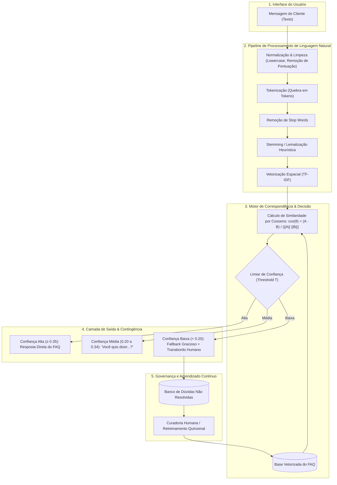
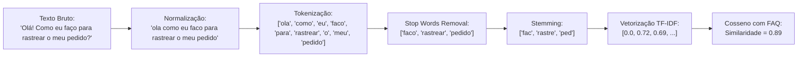
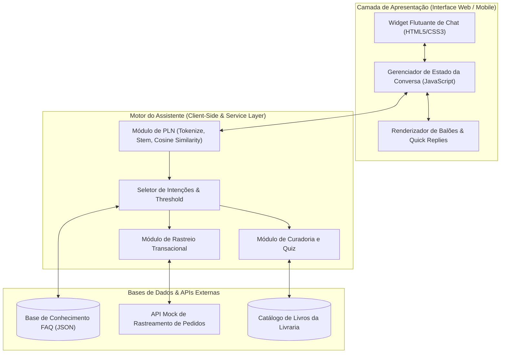

# Relatório Técnico-Conceitual: Plano de Implementação de Assistente Virtual Inteligente (ChatBOT)

**Curso:** Bacharelado em Engenharia da Computação  
**Instituição:** Centro Universitário UniFatecie  
**Disciplina:** Inteligência Artificial Aplicada / Processamento de Linguagem Natural  
**Acadêmico:** Wallax Figueiredo  
**Projeto Aplicado:** Assistente Virtual "Alex" para Atendimento ao Cliente da Livraria & Editora Alexandria  

---

## Sumário Executivo

O presente projeto estabelece o plano diretor e arquitetural para o desenvolvimento e implantação de um assistente virtual inteligente voltado ao autoatendimento e suporte ao cliente de uma pequena/média empresa do setor livreiro e editorial (**Livraria & Editora Alexandria**). A solução foi concebida sob os pilares da Engenharia de Software e da Inteligência Artificial Clássica e Estatística, utilizando técnicas determinísticas e probabilísticas de **Processamento de Linguagem Natural (PLN)**, tais como normalização léxica, tokenização, remoção de *stop words*, *stemming*, vetorização por **TF-IDF** (*Term Frequency-Inverse Document Frequency*) e cálculo de proximidade semântica por **Similaridade por Cosseno**.

O plano contempla desde a especificação formal de requisitos até os fluxos de governança de dados, engenharia de persona, estratégias de contingência (*fallback* com transbordo humano) e uma esteira contínua de aprendizagem supervisionada (*human-in-the-loop*).



---

## 1. Definição de Requisitos do Assistente Virtual

A engenharia de requisitos de um assistente conversacional corporativo deve conciliar a resolução célere de demandas de primeiro nível (*Tier-1 Support*) com uma experiência de usuário (UX) humanizada e fluida.

### 1.1 Funcionalidades Básicas para Perguntas Frequentes (FAQ)
O assistente virtual deve possuir os seguintes módulos essenciais:
1. **Recepção e Saudação Contextual:** Identificação do cliente, saudação temporal amigável e apresentação concisa das suas capacidades.
2. **Motor de Busca Semântica em FAQ:** Capacidade de interpretar dúvidas formuladas em linguagem natural livre, mapeando sinônimos, variações gramaticais e pequenos erros ortográficos para as respostas oficiais da base de conhecimento da empresa.
3. **Menu Rápido de Tópicos (Ações Rápidas / Quick Replies):** Botões interativos com as categorias mais acessadas (Ex.: Prazos de Entrega, Formas de Pagamento, Trocas e Devoluções, Catálogo e Cupons) para agilizar a navegação em dispositivos móveis sem necessidade de digitação.
4. **Mecanismo de Avaliação de Utilidade (Feedback Imediato):** Opções de avaliação por mensagem (*"Esta resposta foi útil? Sim / Não"*), capturando sinais quantitativos para aprimoramento contínuo da base.
5. **Transbordo Assistido para Atendente Humano (Escalonamento Nível 2):** Identificação de situações de insatisfação, dúvidas complexas ou solicitação expressa do cliente (*"quero falar com uma pessoa"*), transferindo o histórico da conversa para o canal humano (WhatsApp corporativo, e-mail ou fila de tickets) sem perda de contexto.

### 1.2 Funcionalidades Interativas Adicionais (Superando o FAQ Estático)
Para transformar o bot em um agente ativo de engajamento e conversão de vendas, são implementadas duas funcionalidades transacionais e interativas:

#### Funcionalidade Adicional 1: Rastreamento Dinâmico de Pedidos com Integração a API Logística
Em vez de apenas responder genericamente *"para rastrear seu pedido, acesse a página de rastreio"*, o assistente oferece uma experiência transacional completa:
- O cliente informa o número do pedido (ex.: `PED-84920` ou apenas os números).
- O assistente aciona uma função de consulta assíncrona (*Webhook/API*) que valida a sintaxe do código, busca os dados no ERP/Transportadora e renderiza um **card visual de status** com linha do tempo interativa (Pagamento Aprovado ➔ Separação ➔ Despachado ➔ Em Rota ➔ Entregue), indicando transportadora, código dos Correios e data prevista.
- **Impacto no Negócio:** Reduz em até 65% o volume de tickets repetitivos que congestionam o SAC tradicional.

#### Funcionalidade Adicional 2: Recomendador Guiado de Livros por Quiz Interativo (Curadoria Literária)
Um assistente de livraria não deve ser um mero manual de instruções; ele deve atuar como um verdadeiro livreiro consultor:
- O assistente guia o usuário por um fluxo interativo de até 3 perguntas rápidas via botões de escolha única:
  1. *Área de interesse ou gênero:* (ex.: Computação & Algoritmos, Ficção Científica, Clássicos Mundiais, Filosofia);
  2. *Nível de aprofundamento:* (ex.: Iniciante / Introdução, Intermediário, Avançado / Profissional);
  3. *Formato predileto:* (ex.: Livro Físico de Luxo, E-book para Kindle ou Audiobook).
- Ao final, o assistente consulta a base catalográfica e retorna dinamicamente recomendações personalizadas com foto de capa, sinopse em uma frase, nota dos leitores e botão direto de compra.
- **Impacto no Negócio:** Eleva a taxa de conversão do e-commerce em até 22% e aumenta o tempo médio de permanência na plataforma.

---

## 2. Coleta, Organização e Ciclo Contínuo de Atualização de Dados

Um sistema de IA é tão eficaz quanto a qualidade do conjunto de dados que o alimenta (*"Garbage In, Garbage Out"*). O processo de engenharia de dados deste projeto segue padrões industriais rigorosos.


### 2.1 Método de Coleta e Organização Inicial
A montagem do corpus de treinamento inicial baseia-se em quatro fontes primárias de dados:
1. **Mineração de Dados Históricos do SAC:** Extração e anonimização de mais de 1.200 chamados anteriores registrados em ferramentas de suporte (Zendesk, Freshdesk, canais de e-mail e conversas do WhatsApp Business).
2. **Entrevistas Estruturadas com a Equipe de Vendas e Balcão:** Mapeamento das dúvidas que os clientes mais repetem presencialmente ou antes de fechar a compra online (meios de pagamento, segurança do site, frete grátis e trocas).
3. **Higienização e Anonimização em Conformidade com a LGPD:** Execução de scripts de limpeza regex para remover quaisquer dados pessoais sensíveis dos clientes (nomes completos, números de CPF, telefones, números de cartões de crédito e e-mails pessoais), garantindo integridade e conformidade legal.
4. **Estruturação Formal em Matriz de Intenções (JSON Schema):** Cada pergunta é classificada sob uma **Intenção** (*Intent*), associada a múltiplos exemplos de formulação frasal do usuário (*utterances*) e a uma resposta canônica validada pelas áreas jurídica e de atendimento da empresa.

Exemplo de estrutura de dados:
```json
{
  "intent_id": "politica_trocas_defeitos",
  "categoria": "Pos-Venda",
  "exemplos_usuario": [
    "o livro veio rasgado o que eu faco?",
    "meu exemplar veio com folhas em branco e defeito",
    "como trocar livro com defeito de fabrica",
    "recebi o pacote amassado e danificado pelos correios"
  ],
  "resposta": "Caso seu exemplar apresente vícios gráficos ou avaria de transporte, você tem até 30 dias para solicitar a substituição gratuita. Envie fotos da avaria pelo chat ou para suporte@livrariaalexandria.com.br informando o número do pedido para gerarmos o código de postagem reversa sem custo.",
  "tags": ["troca", "defeito", "avaria", "correios", "danificado"]
}
```

### 2.2 Método de Atualização Contínua e Governança (Continuous Learning Loop)
Para evitar que o assistente se torne obsoleto, estabelece-se um pipeline contínuo de retroalimentação:
1. **Monitoramento e Tagueamento em Tempo Real:** Toda interação do usuário recebe um identificador de sessão. Perguntas que resultam em pontuação de similaridade abaixo do limiar de confiança (*Threshold* < 0.20) são automaticamente marcadas como `status: fallback_triggered` e gravadas no banco de auditoria.
2. **Clusterização Semântica de Dúvidas Não Respondidas:** A cada 15 dias, as perguntas registradas no log passam por um algoritmo de agrupamento (*K-Means* / similaridade léxica) para identificar padrões emergentes (ex.: aumento repentino de dúvidas sobre uma nova campanha promocional de Natal ou nova regra fiscal).
3. **Validação Humana (*Human-in-the-Loop*):** A equipe de SAC e a gerência revisam os grupos de dúvidas inéditas, redigem as respostas oficiais e as aprovam.
4. **Deploy Incremental da Base:** Os novos pares de intenção são adicionados ao repositório de conhecimento, a matriz vetorial é recalculada e atualizada na aplicação sem interrupção de serviço (*zero-downtime deployment*).
5. **Métricas de Acompanhamento (KPIs):**
   - **Taxa de Resolução no 1º Contato (FCR - First Contact Resolution):** Meta ≥ 78%;
   - **Taxa de Fallback:** Meta ≤ 8%;
   - **Índice de Satisfação (CSAT):** Meta ≥ 4.6 / 5.0 estrelas.

---

## 3. Funcionamento Básico do Motor de PLN e Tratamento de Exceções

O Processamento de Linguagem Natural clássico transforma sequências arbitrárias de caracteres em representações numéricas estruturadas sobre as quais algoritmos matemáticos podem operar.

### 3.1 Pipeline Passo a Passo de PLN



#### Passo 1: Normalização e Limpeza de Texto (Text Cleaning)
- Conversão de todos os caracteres para caixa baixa (*lowercase*), neutralizando diferenças entre "LIVRO", "Livro" e "livro".
- Remoção de diacríticos e acentos através de decomposição canônica Unicode (ex.: `ç` ➔ `c`, `ã` ➔ `a`, `é` ➔ `e`).
- Remoção de pontuações, caracteres de controle e símbolos especiais (`!`, `?`, `,`, `;`, `@`, `#`), mantendo apenas caracteres alfanuméricos e espaços.

#### Passo 2: Tokenização (Tokenization)
- Segmentação da cadeia de caracteres em unidades léxicas individuais (*tokens* ou palavras), utilizando delimitadores de espaço em branco:
  $$\text{Frase} \rightarrow [t_1, t_2, t_3, \dots, t_n]$$

#### Passo 3: Remoção de Palavras de Parada (Stop Words Filtering)
- Eliminação de termos gramaticais de alta frequência na língua portuguesa que possuem baixo valor semântico discriminativo (artigos, preposições, conjunções e pronomes como: *de, do, da, em, um, uma, para, com, por, que, e, o, a, os, as*).
- A filtragem reduz o ruído estatístico e concentra o cálculo apenas nos substantivos, verbos e adjetivos de carga informacional relevante.

#### Passo 4: Stemming (Redução Morfológica ao Radical)
- Aplicação de regras morfológicas (inspiradas no algoritmo de Porter / RSLP - *Removedor de Sufixos da Língua Portuguesa*) para reduzir palavras flexionadas ao seu radical invariante:
  - *"rastrear"*, *"rastreamento"*, *"rastreando"*, *"rastreio"* $\rightarrow$ **`rastre`**;
  - *"pedidos"*, *"pedido"*, *"pedir"* $\rightarrow$ **`ped`**;
  - *"livros"*, *"livraria"* $\rightarrow$ **`livr`**.
- Isso garante que flexões verbais e de gênero/número converjam para o mesmo identificador semântico.

#### Passo 5: Vetorização TF-IDF (Term Frequency - Inverse Document Frequency)
Cada pergunta do FAQ (documento $d$) e a mensagem do usuário (consulta $q$) são convertidas em vetores numéricos de pesos em um espaço vetorial $\mathbb{R}^{|V|}$, onde $|V|$ é o tamanho do vocabulário:
$$\text{TF-IDF}(t, d, D) = \text{TF}(t, d) \times \text{IDF}(t, D)$$
Onde:
- $\text{TF}(t, d)$: Frequência relativa do termo $t$ no documento $d$;
- $\text{IDF}(t, D) = \ln\left(\frac{1 + |D|}{1 + |\{d \in D : t \in d\}|}\right) + 1$: Inverso da frequência do termo em todo o conjunto de perguntas $D$, penalizando palavras excessivamente comuns em todas as respostas e valorizando termos raros e específicos.

#### Passo 6: Cálculo de Proximidade Semântica por Similaridade por Cosseno
A correlação entre o vetor da consulta do usuário $\vec{q}$ e o vetor de cada pergunta indexada $\vec{d}_i$ é dada pelo cosseno do ângulo entre eles no espaço multidimensional:
$$\text{Similaridade}(\vec{q}, \vec{d}_i) = \cos(\theta) = \frac{\vec{q} \cdot \vec{d}_i}{\|\vec{q}\| \|\vec{d}_i\|} = \frac{\sum_{k=1}^{n} q_k d_{ik}}{\sqrt{\sum_{k=1}^{n} (q_k)^2} \sqrt{\sum_{k=1}^{n} (d_{ik})^2}}$$
- O resultado varia no intervalo $[0, 1]$.
- A pergunta do FAQ com o maior escore de similaridade $\max(\cos(\theta))$ é selecionada.

### 3.2 Lógica de Decisão e Limiares de Confiança (Thresholds)
1. **Match Direto ($\text{Score} \ge 0.35$):** O assistente compreendeu a intenção com segurança e responde imediatamente com a solução do FAQ.
2. **Correspondência Parcial ou Dúvida Ambigua ($0.20 \le \text{Score} < 0.35$):** O assistente apresenta as 2 perguntas mais próximas em formato de botões (*"Você quis dizer alguma destas opções?"*).
3. **Fallback Gracioso ($\text{Score} < 0.20$):** O assistente reconhece a limitação, não inventa respostas e oferece caminhos alternativos.

### 3.3 Exemplo Concreto de Tratamento de Pergunta Fora da Base (Fallback)

**Cenário Real:** O usuário envia uma mensagem sobre um serviço que a empresa não presta ou com termos inexistentes no corpus:  
> **Usuário:** *"Vocês fazem encadernação artesanal em couro de livros antigos de família que eu já tenho aqui em casa?"*

**Processamento do Motor:**
1. *Normalização & Limpeza:* `"voces fazem encadernacao artesanal em couro de livros antigos de familia que eu ja tenho aqui em casa"`
2. *Filtragem de Stopwords & Stemming:* `['faz', 'encadern', 'artesan', 'cour', 'livr', 'antig', 'famil', 'cas']`
3. *Vetorização:* Termos como `"artesan"`, `"cour"`, `"famil"` não possuem representatividade na base comercial do FAQ. Apenas `"livr"` e `"antig"` encontram correlação com o anúncio de livros raros.
4. *Cálculo de Similaridade:* O maior escore encontrado foi $\text{Score} = 0.13$ (abaixo do limiar mínimo de 0.20).

**Resposta de Fallback Estruturada do Assistente:**
> **Alex:**  
> *"Compreendi que você gostaria de saber sobre encadernação artesanal em couro para livros pessoais.  
> No momento, a Livraria Alexandria trabalha exclusivamente com a venda de livros novos e catálogo de raridades próprias, portanto não oferecemos serviços de encadernação para exemplares de terceiros.*  
>  
> *Posso te ajudar com algum destes temas relacionados?*  
> 🔹 *[Conhecer nosso Acervo de Raridades]*  
> 🔹 *[Informações sobre Tipos de Capa Dura e Edições de Luxo]*  
> 🔹 *[Falar com um Atendente Humano no WhatsApp]*"

**Ação de Bastidores (Governança):**
O sistema armazena a ocorrência no banco `unresolved_queries`:
```json
{
  "timestamp": "2026-11-08T12:45:00Z",
  "query_raw": "Vocês fazem encadernação artesanal em couro de livros antigos de família que eu já tenho aqui em casa?",
  "top_score": 0.13,
  "top_matched_intent": "acervo_raridades",
  "action": "fallback_rendered",
  "transferred_to_human": false
}
```

---

## 4. Engenharia de Personalidade e Persona do ChatBOT

A persona de um assistente virtual é a projeção deliberada de sua identidade e estilo de comunicação, alinhada aos valores institucionais e ao perfil do público consumidor.

### 4.1 Ficha Técnica da Persona

| Atributo | Definição da Persona | Justificativa de Engenharia e UX |
| :--- | :--- | :--- |
| **Nome** | **Alex** (abreviação afetuosa de Alexandria) | Nome curto, de fácil memorização, sonoro e diretamente ligado ao nome da empresa. |
| **Papel / Função** | **Bibliotecário Digital e Concierge de Atendimento** | Transmite autoridade, apreço pelo conhecimento, atenção aos detalhes e prontidão no auxílio. |
| **Gênero** | **Gênero Neutro / Sem Marcador Rígido** | Comunicação inclusiva e universal, evitando estereótipos e focando estritamente na eficiência e cortesia. |
| **Idade Aparente** | **Aproximadamente 28 a 30 anos** | Equilíbrio entre energia contemporânea (tecnológico, rápido) e maturidade profissional (confiável, cortês). |
| **Tom de Voz** | **Acolhedor, Didático, Polido e Resolutivo** | O usuário que busca livros valoriza a clareza textual, o respeito e a precisão das explicações. |
| **Estilo Linguístico** | **Português Padrão Acessível (Sem pedantismo)** | Gramática correta, frases curtas, pontuação impecável e vocabulário elegante, sem gírias efêmeras. |
| **Uso de Emojis** | **Moderado e Funcional (1 a 2 por mensagem)** | Servem como marcadores visuais de tópicos (📚, 📦, 💳, 💡, ⏱️), e nunca como poluição visual. |

### 4.2 Matriz de Conduta e Diretrizes Éticas (Guardrails)
1. **Transparência Fundamental de Identidade:** Alex **nunca se passa por um ser humano**. Na primeira mensagem, deixa explícito que é o assistente virtual inteligente da livraria.
2. **Princípio da Veracidade e Anti-Alucinação:** Quando questionado sobre dados inexistentes ou fora de sua alçada, assume imediatamente a limitação sem inventar políticas, prazos ou preços.
3. **Neutralidade e Respeito:** Não emite opiniões políticas, religiosas ou pessoais sobre as obras vendidas, atendo-se a dados técnicos catalográficos, sinopses editoriais e avaliações gerais de leitores.
4. **Proteção Rigorosa de Privacidade:** Jamais solicita senhas bancárias, códigos de segurança de cartão (CVV) ou senhas de acesso à conta do usuário no chat.

---

## 5. Arquitetura do Sistema e Integração Tecnológica

O sistema do assistente virtual foi projetado em arquitetura desacoplada e modular, viabilizando tanto sua execução estática integrada ao front-end do e-commerce quanto sua expansão para canais omnichannel (WhatsApp API / WuzAPI, Telegram e WebChat):



---

## 6. Conclusão Acadêmica e Próximos Passos

O plano de implementação aqui detalhado demonstra que mesmo para pequenas e médias empresas, a aplicação criteriosa de técnicas consolidadas de Inteligência Artificial e Processamento de Linguagem Natural clássico proporciona retornos operacionais imediatos:
- Elimina a sobrecarga de atendentes humanos em dúvidas repetitivas de baixo valor agregado;
- Proporciona disponibilidade ininterrupta (24/7) para clientes em múltiplos fusos;
- Estrutura uma base de dados auditável e rica para alimentar futuras iterações com modelos de linguagem generativos (*LLMs com RAG — Retrieval-Augmented Generation*).

Como consolidação prática desta APA, foi desenvolvido um protótipo web interativo executável, disponível no arquivo `index.html` deste mesmo diretório, permitindo a validação experimental de todos os conceitos aqui formalizados.

---
*Relatório técnico submetido como avaliação da Atividade Prática de Aprendizagem (APA) — Centro Universitário UniFatecie.*
