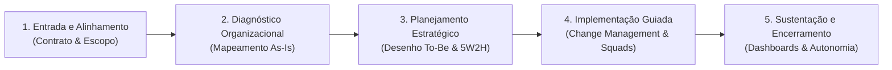
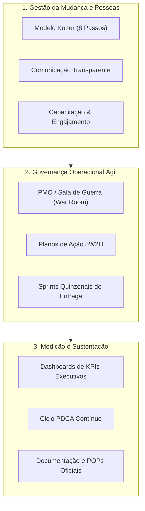

<style>
  body {
    font-family: 'Segoe UI', -apple-system, BlinkMacSystemFont, Roboto, 'Helvetica Neue', Arial, sans-serif;
    line-height: 1.7;
    color: #1e293b;
    max-width: 900px;
    margin: 0 auto !important;
    padding: 20px;
    background-color: #ffffff;
  }
  .doc-container {
    max-width: 860px;
    margin: 0 auto;
    text-align: left;
  }
  .center-box {
    text-align: center !important;
    margin-left: auto;
    margin-right: auto;
  }
  .institution-header {
    text-align: center;
    border-bottom: 3px double #1e3a8a;
    padding-bottom: 18px;
    margin-bottom: 25px;
  }
  .badge-container {
    display: flex;
    justify-content: center;
    gap: 8px;
    flex-wrap: wrap;
    margin: 12px 0;
  }
  .card-box {
    background: #f8fafc;
    border: 1px solid #cbd5e1;
    border-left: 5px solid #2563eb;
    border-radius: 6px;
    padding: 16px 20px;
    margin: 20px 0;
  }
  .highlight-card {
    background: #eff6ff;
    border: 1px solid #bfdbfe;
    border-radius: 8px;
    padding: 18px 22px;
    margin: 18px 0;
  }
  table {
    width: 100%;
    border-collapse: collapse;
    margin: 20px 0;
    font-size: 0.95em;
  }
  th {
    background-color: #1e3a8a;
    color: #ffffff;
    font-weight: 600;
    text-align: left;
    padding: 12px 14px;
    border: 1px solid #1e3a8a;
  }
  td {
    padding: 10px 14px;
    border: 1px solid #e2e8f0;
  }
  tr:nth-child(even) {
    background-color: #f8fafc;
  }
  h1, h2, h3, h4 {
    color: #0f172a;
    font-weight: 700;
  }
  h1 { font-size: 1.85rem; margin-top: 20px; }
  h2 { font-size: 1.45rem; border-bottom: 2px solid #e2e8f0; padding-bottom: 8px; margin-top: 35px; }
  h3 { font-size: 1.2rem; color: #1e40af; margin-top: 25px; }
  .footer-sig {
    text-align: center;
    margin-top: 45px;
    padding-top: 25px;
    border-top: 1px solid #cbd5e1;
  }
  @media print {
    body {
      max-width: 100%;
      padding: 0;
      color: #000;
    }
    .page-break {
      page-break-after: always;
    }
  }
</style>

<div class="doc-container">

<div class="institution-header">
  <p style="font-size: 0.9rem; letter-spacing: 0.1em; text-transform: uppercase; color: #64748b; margin-bottom: 4px; font-weight: 600;">
    Centro Universitário UniFatecie
  </p>
  <p style="font-size: 1.15rem; font-weight: 700; color: #1e3a8a; margin: 0;">
    Bacharelado em Engenharia da Computação
  </p>
  <p style="font-size: 1.0rem; font-weight: 600; color: #334155; margin: 4px 0 0 0;">
    Disciplina: Projeto Integrador III
  </p>
</div>

<div class="center-box">

# ATIVIDADE PRÁTICA DE APRENDIZAGEM (APA)
### RELATÓRIO TÉCNICO DE CONSULTORIA EMPRESARIAL E REESTRUTURAÇÃO OPERACIONAL

<div class="badge-container">
  
  
  
  
</div>

<p style="color: #475569; font-size: 0.95rem; margin-top: 6px;">
  <strong>Tema Central:</strong> Diagnóstico Sistêmico, Metodologias de Causa-Raiz e Implementação de Soluções Estratégicas no Varejo de Eletrônicos
</p>

</div>

---

<div class="highlight-card">
  <h3 style="margin-top: 0; color: #1e3a8a; display: flex; align-items: center; gap: 8px;">
    📋 Estudo de Caso Fictício: Necessidade de Consultoria Empresarial
  </h3>
  <p style="text-align: justify; margin-bottom: 0;">
    <em>"A <strong>empresa XYZ</strong> é uma empresa de varejo que vende produtos eletrônicos. Ela está enfrentando uma série de desafios, incluindo baixas vendas, aumento de reclamações de clientes, alta rotatividade de funcionários e falta de inovação em seus produtos. A empresa está preocupada com a sua posição no mercado e acredita que precisa de ajuda para resolver esses problemas e melhorar seu desempenho geral. Eles decidem contratar uma consultoria empresarial para ajudá-los a enfrentar esses desafios."</em>
  </p>
</div>

---

## 📌 Sumário Executivo do Projeto de Consultoria

O presente relatório técnico apresenta uma proposta metodológica e estruturada de **Consultoria Empresarial**, formulada para diagnosticar, intervir e restabelecer a sustentabilidade operacional e competitiva da **Empresa XYZ**. 

A organização opera no segmento de varejo de eletrônicos — um mercado dinâmico, de alta intensidade competitiva, margens comprimidas e ciclo de vida de produtos curto. O diagnóstico inicial revela um efeito cascata gerado por quatro fragilidades críticas interconectadas:

1. **Baixas Vendas:** Queda contínua de receita e perda progressiva de fatia de mercado (*market share*);
2. **Reclamações Crescentes de Clientes:** Degradação da experiência do consumidor (*CX*), ineficiência no SAC e falhas no pós-venda/garantia;
3. **Elevada Rotatividade de Funcionários (Turnover):** Desmotivação da equipe, perda de capital intelectual, liderança reativa e sobrecarga operacional;
4. **Defasagem no Portfólio (Falta de Inovação):** Catálogo estagnado, dependência de linhas de produtos obsoletas e ausência de canais omnicanal (*Omnichannel*).

A seguir, apresentam-se as soluções fundamentadas e detalhadas para as três questões práticas solicitadas.

---

## 🧭 Questão Prática 1: Principais Etapas da Consultoria Empresarial

Para que a consultoria produza resultados mensuráveis e sustentáveis na **Empresa XYZ**, o consultor deve conduzir um processo estruturado em **5 grandes etapas metodológicas**, integrando as melhores práticas da gestão de projetos, engenharia de processos e gestão estratégica:



### Etapa 1: Entrada, Sensibilização e Alinhamento de Expectativas
* **Objetivo:** Estabelecer a relação formal, alinhar papéis e responsabilidades com a alta liderança e definir a governança da consultoria.
* **Ações Principais:**
  - Realização do *Kick-off Meeting* (reunião inaugural) com a diretoria, gerentes de lojas e lideranças de setor;
  - Definição do escopo formal de trabalho, limites de atuação, matriz de responsabilidades (RACI) e cronograma macro;
  - Criação de um ambiente de confiança mútua, desmistificando a figura do consultor e deixando claro aos colaboradores que o objetivo é capacitar e otimizar processos, e não realizar cortes indiscriminados.

### Etapa 2: Diagnóstico Organizacional Aprofundado (Mapeamento *As-Is*)
* **Objetivo:** Compreender a real anatomia dos problemas, distinguindo sintomas superficiais de causas estruturais raízes.
* **Ações Principais:**
  - Coleta abrangente de dados quantitativos: relatórios de faturamento dos últimos 24 meses, margem de contribuição por categoria de eletrônicos, taxas de conversão de visitantes em clientes, índices de *turnover* por setor, índices de absenteísmo, dados de SAC e tempo médio de atendimento;
  - Coleta de dados qualitativos: entrevistas individuais em profundidade com colaboradores de linha de frente, aplicação de pesquisa de clima organizacional, mapeamento da jornada de compra com clientes e visitas *in loco* (prática do *Gemba Walk*);
  - Aplicação de análises estratégicas consagradas: Análise SWOT (Forças, Fraquezas, Oportunidades e Ameaças), Análise das 5 Forças de Porter no setor varejista e Matriz BCG do portfólio de eletrônicos.

### Etapa 3: Planejamento Estratégico e Formulação das Soluções (Desenho *To-Be*)
* **Objetivo:** Projetar o estado futuro ideal e viável da empresa, cocriando soluções práticas em parceria com a equipe interna.
* **Ações Principais:**
  - Redefinição dos Objetivos Estratégicos através da metodologia **OKRs** (*Objectives and Key Results*);
  - Redesenho dos processos críticos: remodelagem do atendimento ao cliente, política moderna de trocas e garantias, reestruturação da política comercial de comissões e metodologia ágil de curadoria de novos produtos;
  - Priorização das ações de melhoria através da **Matriz GUT** (Gravidade, Urgência e Tendência) e elaboração dos planos táticos baseados na ferramenta **5W2H**.

### Etapa 4: Implementação Guiada e Gestão da Mudança (*Execution*)
* **Objetivo:** Tirar as soluções do papel de forma disciplinada, minimizando atritos e resistências operacionais.
* **Ações Principais:**
  - Adoção da metodologia de Gestão da Mudança baseada nos **8 Passos de John Kotter** e no modelo **ADKAR** (*Awareness, Desire, Knowledge, Ability, Reinforcement*);
  - Formação de *squads* multifuncionais internos para conduzir frentes prioritárias (Vendas, Atendimento, RH e Produtos);
  - Execução de testes-piloto em lojas ou setores selecionados para validação rápida de hipóteses antes do lançamento em larga escala;
  - Programas intensivos de capacitação, treinamentos técnicos de produto e desenvolvimento de liderança humanizada.

### Etapa 5: Monitoramento Contínuo, Sustentação e Encerramento Formal
* **Objetivo:** Garantir que as melhorias se consolidem na cultura da empresa e que ela mantenha alto desempenho de forma independente após a saída do consultor.
* **Ações Principais:**
  - Implantação de painéis de gestão à vista (*Dashboards* e *Scorecards* com KPIs em tempo real);
  - Instituição de rituais quinzenais de controle e calibragem através do ciclo **PDCA** (*Plan, Do, Check, Act*);
  - Documentação de Manuais de Procedimento Operacional Padrão (POPs) e *Playbooks* de Atendimento e Vendas;
  - Relatório final de impacto financeiro e operacional, transferência formal de conhecimento aos líderes internos e encerramento do contrato.

---

## 🔍 Questão Prática 2: Identificação de Causas-Raiz e Desenvolvimento de Soluções Eficazes

Um erro comum em intervenções empresariais é combater apenas os sintomas (ex.: criar uma campanha publicitária pontual para tentar subir as vendas sem entender por que o cliente está insatisfeito). O consultor profissional deve aplicar métodos analíticos rigorosos para mapear a gênese dos problemas.

### 1. Ferramentas Analíticas Aplicadas ao Diagnóstico

#### A) Diagrama de Causa e Efeito (Ishikawa / 6M)
O Diagrama de Espinha de Peixe decompõe os fatores geradores da crise na Empresa XYZ nas seguintes categorias:

* **Método:** Processos de atendimento burocráticos, ausência de padrão no pós-venda, canal de SAC engessado e sem autonomia para resolver queixas no primeiro contato (*First Contact Resolution*);
* **Mão de Obra:** Equipe desmotivada com alto índice de demissões, carência de treinamento técnico sobre as especificações dos eletrônicos e liderança autocrática com foco exclusivo em cobrança;
* **Máquina / Tecnologia:** Sistemas de PDV (Ponto de Venda) legados e lentos, ausência de ferramenta moderna de CRM (*Customer Relationship Management*) e inexistência de plataforma de e-commerce integrada (ausência de omnicanalidade);
* **Medição:** Metas de vendas puramente transacionais, sem indicadores de fidelização, índice de recompra ou satisfação do cliente (NPS);
* **Material / Produto:** Mix de eletrônicos desatualizado, marcas secundárias sem apelo tecnológico, quebras frequentes de estoque de produtos com alta procura e acordos comerciais fracos com grandes fabricantes;
* **Meio Ambiente / Mercado:** Concorrência agressiva de grandes *marketplaces* e plataformas digitais com entrega ultrarrápida e preços agressivos.

#### B) Técnica dos 5 Porquês (Análise de Causa Fundamental)
Exemplo prático aplicado à evasão de funcionários (*turnover*):
1. *Por que a rotatividade de funcionários está alta?* Porque os vendedores e atendentes pedem demissão após 3 a 6 meses de empresa.
2. *Por que eles pedem demissão tão rápido?* Porque relatam cansaço extremo, desmotivação financeira e constante frustração no ambiente de trabalho.
3. *Por que sentem essa frustração constante?* Porque passam a maior parte do dia lidando com clientes irritados e não batem as metas de vendas.
4. *Por que não batem as metas e os clientes estão sempre irritados?* Porque os produtos disponíveis têm pouca demanda, apresentam defeitos recorrentes e a empresa não possui peças de reposição nem autoriza trocas imediatas.
5. *Por que os produtos são defasados e a política de troca é travada?* **Causa-raiz:** Porque as decisões de compras são centralizadas e sem análise de dados de mercado, e as diretrizes de atendimento foram desenhadas para proteger o caixa a curto prazo, ignorando a experiência do cliente e o suporte aos vendedores.

---

### 2. Matriz de Soluções Eficazes para os 4 Eixos Críticos

Para cada desafio diagnosticado, o consultor deve estruturar soluções de alto impacto sistêmico:

<table>
  <thead>
    <tr>
      <th style="width: 20%;">Eixo do Problema</th>
      <th style="width: 35%;">Causas-Raiz Mapeadas</th>
      <th style="width: 45%;">Soluções Estratégicas Recomendadas</th>
    </tr>
  </thead>
  <tbody>
    <tr>
      <td><strong>1. Baixas Vendas</strong></td>
      <td>
        • Dependência exclusiva de vendas em loja física;<br/>
        • Ausência de abordagem consultiva;<br/>
        • Falta de campanhas baseadas em dados de clientes.
      </td>
      <td>
        • <strong>Estratégia Omnichannel:</strong> Implantação de venda híbrida (compre no site/WhatsApp e retire na loja no mesmo dia);<br/>
        • <strong>CRM Ativo e Segmentado:</strong> Ofertas personalizadas com base no histórico de compras e ciclo de substituição de eletrônicos;<br/>
        • <strong>Venda Consultiva:</strong> Treinar os vendedores como "especialistas em tecnologia", agregando serviços de valor (garantia estendida, suporte de configuração e seguro de tela/dispositivos).
      </td>
    </tr>
    <tr>
      <td><strong>2. Reclamações de Clientes</strong></td>
      <td>
        • Burocracia excessiva para trocas e acionamento de garantia;<br/>
        • Falta de alinhamento entre o que é prometido e entregue;<br/>
        • Canais de suporte lentos e reativos.
      </td>
      <td>
        • <strong>Política "Troca sem Fricção":</strong> Troca imediata na loja para defeitos relatados em até 30 dias;<br/>
        • <strong>Atendimento Humanizado & Ágil:</strong> Implementação de canal de SAC via WhatsApp com respostas imediatas e painel centralizado de chamados;<br/>
        • <strong>Controle de Qualidade de Fornecedores:</strong> Monitorar lotes com defeito e descredenciar fornecedores com taxa de devolução acima de 2%.
      </td>
    </tr>
    <tr>
      <td><strong>3. Alta Rotatividade (Turnover)</strong></td>
      <td>
        • Metas inalcançáveis gerando desânimo;<br/>
        • Liderança despreparada para gerir pessoas;<br/>
        • Ausência de perspectivas de crescimento e plano de carreira.
      </td>
      <td>
        • <strong>Plano de Cargos, Salários e Carreira (PCCR):</strong> Critérios claros de progressão (Júnior, Pleno, Sênior e Liderança);<br/>
        • <strong>Comissionamento Inteligente:</strong> Remuneração variável atrelada não apenas ao volume financeiro, mas também à satisfação do cliente (bônus por NPS);<br/>
        • <strong>Programa de Onboarding e Treinamento Contínuo:</strong> Trilha de capacitação nos primeiros 90 dias com mentoria de funcionários veteranos.
      </td>
    </tr>
    <tr>
      <td><strong>4. Falta de Inovação</strong></td>
      <td>
        • Compras baseadas em intuição, e não em demanda de mercado;<br/>
        • Portfólio engessado em linhas de baixa tecnologia;<br/>
        • Ausência de parcerias com marcas líderes e novos nichos.
      </td>
      <td>
        • <strong>Comitê de Curadoria e Inovação:</strong> Atualização mensal de tendências (casa inteligente/IoT, periféricos gamers, áudio profissional e wearables);<br/>
        • <strong>Espaço de Experiência na Loja:</strong> Bancadas interativas onde o consumidor pode testar os eletrônicos antes da compra (*Store-in-Store*);<br/>
        • <strong>Modelo de Compras Ágeis (MVP de Portfólio):</strong> Aquisição de lotes menores de novidades tecnológicas para testar aceitação antes de compras em escala.
      </td>
    </tr>
  </tbody>
</table>

---

## 🚀 Questão Prática 3: Implementação Bem-Sucedida e Garantia de Sustentabilidade

A elaboração de um relatório de consultoria brilhante é inútil se as soluções não forem incorporadas ao dia a dia da organização. Para garantir a execução efetiva e perene, o consultor deve estruturar a governança em **três pilares fundamentais**:



### 1. Gestão Ativa da Mudança (*Change Management*)
A principal razão do fracasso de consultorias é a **resistência cultural**. Para mitigar esse risco, o consultor deve aplicar o modelo de 8 passos de John Kotter:

1. **Criar senso de urgência:** Explicar com clareza aos colaboradores a real situação da Empresa XYZ e as oportunidades de recuperação se todos cooperarem;
2. **Formar uma coalizão administrativa forte:** Escolher líderes informais e funcionários respeitados pelos colegas para serem os "embaixadores da mudança";
3. **Desenvolver uma visão e estratégia claras:** Traduzir os novos rumos em objetivos simples e tangíveis;
4. **Comunicar a visão amplamente:** Realizar reuniões semanais abertas (*All-Hands*) para esclarecer dúvidas e apresentar o progresso;
5. **Empoderar os colaboradores e remover barreiras:** Conceder autonomia para os vendedores resolverem problemas de clientes e eliminar regras burocráticas inúteis;
6. **Gerar vitórias de curto prazo (*Quick Wins*):** Resolver rapidamente problemas que incomodam a equipe há tempos (ex.: simplificar o sistema de trocas ou melhorar o ambiente de descanso) para comprovar que a mudança é real e vantajosa;
7. **Consolidar os ganhos e produzir mais mudanças:** Aproveitar a credibilidade das primeiras conquistas para acelerar as transformações mais complexas (como a implementação do e-commerce);
8. **Ancorar as novas abordagens na cultura da empresa:** Atualizar os manuais de conduta e celebrar os sucessos publicamente.

---

### 2. Governança da Execução através do Plano 5W2H
Cada iniciativa deve ser formalizada com donos, prazos e métodos de validação claros. Segue o modelo prático desenhado para as ações prioritárias da Empresa XYZ:

<table>
  <thead>
    <tr>
      <th>O que fazer? (What)</th>
      <th>Por que fazer? (Why)</th>
      <th>Onde fazer? (Where)</th>
      <th>Quem fará? (Who)</th>
      <th>Quando? (When)</th>
      <th>Como fazer? (How)</th>
      <th>Quanto custa? (How Much)</th>
    </tr>
  </thead>
  <tbody>
    <tr>
      <td><strong>Reformulação do SAC e Política de Trocas</strong></td>
      <td>Reduzir reclamações e recuperar a confiança do cliente</td>
      <td>Lojas físicas e canal digital</td>
      <td>Gerente de Atendimento + Consultor</td>
      <td>Semanas 1 a 4</td>
      <td>Criação de procedimento de troca em 1 clique e canal de WhatsApp com SLA de 5 min</td>
      <td>R$ 4.500,00 (software de atendimento)</td>
    </tr>
    <tr>
      <td><strong>Implantação do Novo Mix de Eletrônicos (Inovação)</strong></td>
      <td>Aumentar vendas e atrair público jovem/conectado</td>
      <td>Setor de Compras e Estoque</td>
      <td>Diretor Comercial + Especialista</td>
      <td>Semanas 3 a 8</td>
      <td>Negociação direta com distribuidores de IoT, Gamers e acessórios premium</td>
      <td>R$ 60.000,00 (capital de giro alocado)</td>
    </tr>
    <tr>
      <td><strong>Revisão do Plano de Carreira e Comissões</strong></td>
      <td>Estancar o turnover e engajar o time de vendas</td>
      <td>Departamento de RH / Operações</td>
      <td>Consultor de RH + Diretoria</td>
      <td>Semanas 2 a 6</td>
      <td>Estruturação de comissão escalonada com bônus atrelado ao NPS do cliente</td>
      <td>Sem custo fixo (comissão variável autosustentável)</td>
    </tr>
    <tr>
      <td><strong>Programa de Treinamento Técnico e Consultivo</strong></td>
      <td>Elevar a taxa de conversão e ticket médio</td>
      <td>Sala de treinamento e plataforma EAD</td>
      <td>Líderes de Setor + Fabricantes</td>
      <td>Contínuo (início semana 4)</td>
      <td>Workshops semanais de 1 hora com demonstração prática de aparelhos</td>
      <td>R$ 2.000,00 (materiais e coffee break)</td>
    </tr>
  </tbody>
</table>

---

### 3. Painel de Controle e Indicadores de Desempenho (Dashboard de KPIs)

O sucesso contínuo da Empresa XYZ deve ser monitorado objetivamente através de quatro dimensões estratégicas:

```
+---------------------------------------------------------------------------------------------------+
|                           PAINEL EXECUTIVO DE INDICADORES (KPIs) - EMPRESA XYZ                    |
+--------------------------+-----------------------------+--------------------+---------------------+
|      Dimensão            |          Indicador          |   Situação Atual   |    Meta (180 Dias)  |
+--------------------------+-----------------------------+--------------------+---------------------+
| 1. Comercial & Finanças  | Faturamento Mensal          | R$ 380.000,00      | R$ 520.000,00 (+36%)|
|                          | Ticket Médio                | R$ 220,00          | R$ 340,00           |
|                          | Margem de Contribuição      | 14%                | 22%                 |
+--------------------------+-----------------------------+--------------------+---------------------+
| 2. Experiência (CX)      | Net Promoter Score (NPS)    | 18 (Crítico)       | 68 (Zona Qualidade) |
|                          | Taxa de Reclamações no SAC  | 14,2% das vendas   | < 2,5% das vendas   |
|                          | Resolução no 1º Contato     | 31% dos chamados   | > 85% dos chamados  |
+--------------------------+-----------------------------+--------------------+---------------------+
| 3. Gestão de Pessoas     | Índice de Turnover Mensal   | 11,5% ao mês       | < 2,8% ao mês       |
|                          | eNPS (Clima Interno)        | -24 (Zona Crítica) | +45 (Zona Positiva) |
|                          | Horas de Treinamento/Colab. | 2 horas/ano        | 24 horas/ano        |
+--------------------------+-----------------------------+--------------------+---------------------+
| 4. Inovação & Portfólio  | Faturamento com Lançamentos | 4% do total        | > 28% do total      |
|                          | Giro de Estoque de Novidades| 1,2x ao ano        | 4,5x ao ano         |
+--------------------------+-----------------------------+--------------------+---------------------+
```

---

### 4. Plano de Sustentação Operacional e Saída Planejada da Consultoria
Para assegurar que as mudanças perdurem por anos sem criar dependência crônica do consultor, adota-se o seguinte protocolo de transferência de autonomia:

1. **Instituição do Comitê de Melhoria Contínua:** Formado por funcionários internos de destaque, responsáveis por rodar reuniões quinzenais de auditoria do método PDCA;
2. **Elaboração da Biblioteca de POPs (Procedimentos Operacionais Padrão):** Manuais ilustrados cobrindo desde a abertura da loja, abordagem de clientes, testes de bancada até logística reversa de devoluções;
3. **Auditorias Pós-Implementação (Follow-up):** O consultor programa revisões formais de 30, 60, 90 e 180 dias após a conclusão do projeto, avaliando se os indicadores permanecem na trajetória planejada e realizando pequenos ajustes de curso.

---

## 🎯 Considerações Finais e Conclusão

A intervenção da consultoria empresarial na **Empresa XYZ** demonstra que problemas mercadológicos, humanos e operacionais não ocorrem de forma isolada; eles são manifestações de um **sistema interdependente**. A queda nas vendas e a estagnação tecnológica eram, na verdade, alimentadas pelo desânimo da equipe de ponta e pela frustração dos clientes com a burocracia do pós-venda.

Ao conduzir a reestruturação por meio de um método sólido (Diagnóstico profundo, Mapeamento de Causa-Raiz com Ishikawa/5 Porquês, Cocriação de Soluções com a equipe interna e Gestão Disciplinada da Mudança com apoio de ferramentas ágeis e indicadores transparentes), a consultoria não apenas resgata a rentabilidade da Empresa XYZ, mas cria uma **cultura perene de inovação, foco no cliente e valorização do capital humano**.

---

## 📚 Referências Bibliográficas (Normas ABNT)

* **CHIAVENATO, Idalberto.** *Gestão de Pessoas: o novo papel dos recursos humanos nas organizações.* 4. ed. Barueri: Manole, 2014.
* **KAPLAN, Robert S.; NORTON, David P.** *A Estratégia em Ação: Balanced Scorecard.* 22. ed. Rio de Janeiro: Elsevier, 1997.
* **KOTLER, Philip; ARMSTRONG, Gary.** *Princípios de Marketing.* 16. ed. São Paulo: Pearson Education do Brasil, 2015.
* **KOTTER, John P.** *Liderando Mudanças.* 2. ed. Rio de Janeiro: Alta Books, 2017.
* **KUBR, Milan.** *Management Consulting: A guide to the profession.* 4. ed. Genebra: International Labour Office (ILO), 2002.
* **SLACK, Nigel; BRANDON-JONES, Alistair; JOHNSTON, Robert.** *Administração da Produção.* 8. ed. São Paulo: Atlas, 2018.

---

<div class="footer-sig">
  <p style="font-weight: 700; color: #1e3a8a; margin-bottom: 2px;">
    Wallax Figueiredo
  </p>
  <p style="font-size: 0.9rem; color: #64748b; margin: 0;">
    Acadêmico de Engenharia da Computação — Centro Universitário UniFatecie
  </p>
  <p style="font-size: 0.85rem; color: #94a3b8; margin-top: 4px;">
    Projeto Integrador III • Ano Letivo 2026
  </p>
</div>

</div>
